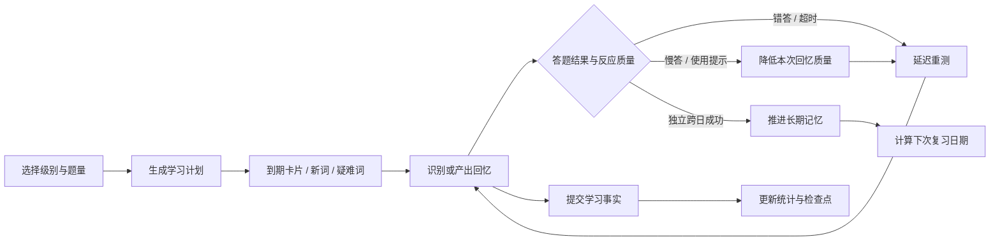

# 词汇闪卡（CEFR3000）

一个离线优先的 Flutter 英语词汇学习应用，把选择题测试、看义拼词、即时纠错、长期记忆调度和学习统计放进同一个可恢复的学习闭环。

## 功能概览 ✨

- **智能闪卡系统**: 基于记忆曲线的单词复习机制
- **词库范围**: 当前内置 3,177 条 A1–B2 词条记录，暂不宣称包含 C1/C2
- **语音朗读**: 内置TTS功能，帮助正确发音
- **进度追踪**: 详细的学习进度和统计分析
- **离线学习**: 支持离线使用，随时随地学习
- **现代UI**: 简洁美观的Material Design界面

## 功能介绍 🎯

### 主要功能
- 📖 **单词测试**: 多选题形式的单词测试
- 🔄 **智能复习**: 根据记忆曲线安排复习
- 📊 **学习统计**: 详细的学习数据分析
- 🎵 **语音朗读**: 标准英语发音
- ⏱️ **计时测试**: 限时答题提高反应速度
- 🎨 **主题切换**: 支持浅色/深色主题

### 技术特点
- 使用Flutter框架开发，当前包含 Android、iOS 和 macOS 工程
- Riverpod状态管理，响应式编程
- SQLite 保存学习核心数据，Hive 负责词库、兼容读取和旧版本迁移适配
- 现代化的UI设计，流畅的用户体验

## 应用图标 🎨

应用采用了全新设计的图标，融合了以下元素：
- 📋 **闪卡元素**: 体现核心学习方式
- 🔤 **字母A**: 代表学习和知识
- 🌟 **装饰元素**: 增加视觉吸引力
- 🎨 **渐变色彩**: 现代化的视觉效果

图标设计理念：
- 主色调：蓝色渐变（#2196F3 → #1976D2）
- 强调色：金黄色（#FFD54F）
- 风格：简洁现代，符合Material Design规范

## 快速开始 📱

### Android
1. 安装 Flutter 3.9+ 和对应平台 SDK
2. 在项目目录执行 flutter pub get
3. 运行 flutter devices 查看设备
4. 执行 flutter run -d <device-id>

### iOS
1. 安装 Xcode 并配置签名
2. 执行 flutter run -d <ios-device-id>

## 开发信息 👨‍💻

### 技术栈
- **框架**: Flutter 3.9+
- **语言**: Dart
- **状态管理**: Riverpod
- **本地存储**: SQLite + Hive + SharedPreferences
- **语音合成**: flutter_tts
- **UI组件**: Material Design 3

### 项目结构
```
lib/
├── data/           # 数据层
├── domain/         # 业务逻辑层
├── models/         # 数据模型
├── screens/        # 页面UI
├── session/        # 会话管理
├── theme/          # 主题配置
├── utils/          # 工具类
└── widgets/        # 通用组件
```

## 更新日志 📝

### v0.1.0 (2025-08-27)
- ✅ 修复测试界面溢出问题
- ✅ 更新应用名称为"词汇闪卡"
- ✅ 设计并应用新的应用图标
- ✅ 优化界面布局和用户体验
- ✅ 完善文档和说明

## 反馈与支持 💬

如果您在使用过程中遇到问题或有改进建议，欢迎通过以下方式联系我们：

- 📧 邮箱: support@vocabflash.app
- 🐛 问题反馈: GitHub Issues
- ⭐ 应用评分: App Store / Google Play

## 许可证 📄

当前仓库尚未附带正式 LICENSE 文件；如要开源发布，请补充明确的许可证文本。

---

**词汇闪卡** - 让英语学习更高效！ 🚀

## 核心学习闭环



### 业务边界

1. **答题结果**（正确、错误、超时）与**反应质量**（快速、普通、慢速、辅助、失败）分开记录。
2. 轮内重测只用于即时纠错，不伪造独立的长期复习次数，也不重复累计长期失忆惩罚。
3. 延迟重测使用“第几道题后可重出”的绝对题号，不依赖每道题都修改倒计时器。
4. 总结页默认按每个词的**首次作答**计算准确率，同时展示总作答、纠错成功率和错词集合。
5. 每个词有重试上限，会话还有总作答上限，持续答错时队列仍能确定性结束。

## 主要学习模式

### 四选一识别

出题时优先使用相同 CEFR 等级和主词性的候选词生成干扰项；不足时才跨等级放宽，并对释义做去重和互斥检查。选项顺序使用可复现的随机种子，避免固定位置规律。

### 看义拼词

产出模式按认知负荷分级提示：

- Level 0：完全自主拼写
- Level 1：揭示辅音骨架
- Level 2：揭示关键元音和首字母，同时强制保留至少一个空白槽位
- Level 3：补全全词用于核对

使用提示会降低本次回忆质量，不会被当作一次完整的独立成功复习。

### 轮内延迟重测

- 错答和超时默认进入延迟队列；勉强答对可以按较长延迟进入重测。
- 重测受最近词冷却窗口保护，避免只依赖瞬时工作记忆。
- 重测次数与长期 SRS 调度分离；轮内重测不会增加长期复习次数。
- 主队列和延迟队列都耗尽，或达到总作答上限后，会话才结束并标记未解决词。

## 长期记忆与统计

每次有效提交会保存答题结果、反应时间、提示级别和尝试类型。长期调度关注稳定度、难度、复习间隔和失忆次数；FSRS 参考结果目前仅作为影子计算，不会未经跨日样本验证直接替换线上自定义 SRS。

总结页同时保留两套视角：

- **首答准确率**：衡量第一次检索是否成功，避免重复重测稀释或膨胀指标。
- **总作答与纠错成功率**：反映即时补救是否有效。

## 技术栈

- Flutter / Dart 3.9+
- Riverpod 2
- SQLite（sqflite）学习核心存储
- Hive 词库与迁移兼容层
- SharedPreferences 设置
- flutter_tts 本地语音
- json_serializable、Hive Generator

## 项目结构

```text
lib/
├── core/                   # 核心配置与基础能力
├── data/                   # SQLite、Hive、迁移和外部服务适配
├── domain/                 # 题目、干扰项、SRS 等领域规则
├── features/
│   ├── lexicon/            # 词条资格与产出提示
│   ├── memory/             # 回忆证据、能力状态和记忆调度
│   ├── progress/           # 进度分析
│   └── study/              # 学习计划、检查点和提交流程
├── models/                 # Word、Attempt、CardState 等模型
├── screens/                # 页面 UI
├── session/                # 测试会话状态机和延迟重测
├── services/               # 历史记录、计划和辅助服务
├── theme/                  # 主题系统
└── widgets/                # 通用 UI 组件
```

## 开发命令

```bash
flutter pub get
flutter test --no-pub
flutter analyze --no-pub
```

修改带有 HiveType 或 JsonSerializable 注解的模型后，重新生成代码：

```bash
dart run build_runner build --delete-conflicting-outputs
```

## 数据与隐私

- 学习进度、答题记录和会话检查点以本地数据为主，核心学习路径不依赖网络。
- AI 解释是可选辅助能力，不能覆盖词库中的标准释义或答案。
- API 密钥不得写入源码、版本库或普通偏好配置。
- 提交 Issue 时请删除个人学习记录、密钥和其他敏感信息。

## 开发文档

- [单词记忆核心架构设计规划](docs/单词记忆核心架构设计规划.md)
- [重构升级实施状态](docs/重构升级实施状态.md)
- [学习模式实现说明](LEARNING_MODE_IMPLEMENTATION.md)
- [SRS 算法分析](SRS_ALGORITHM_ANALYSIS.md)

## 当前限制

- 当前词库为 A1–B2；C1/C2 数据尚未随资源提供。
- FSRS 仍处于影子调度阶段，需要真实跨日样本后再决定是否切换。
- 真机、跨平台签名和发布包验证需要在对应平台环境中单独执行。

## 反馈

欢迎通过 [GitHub Issues](https://github.com/zhiwu2006/CEFR3000/issues) 提交 Bug、功能建议或词库问题。请附上复现步骤、平台和 Flutter 版本，不要上传个人数据或密钥。

## 许可证说明

当前仓库尚未附带正式 LICENSE 文件。若要作为开源软件发布，请在公开仓库中补充明确的许可证文本。
