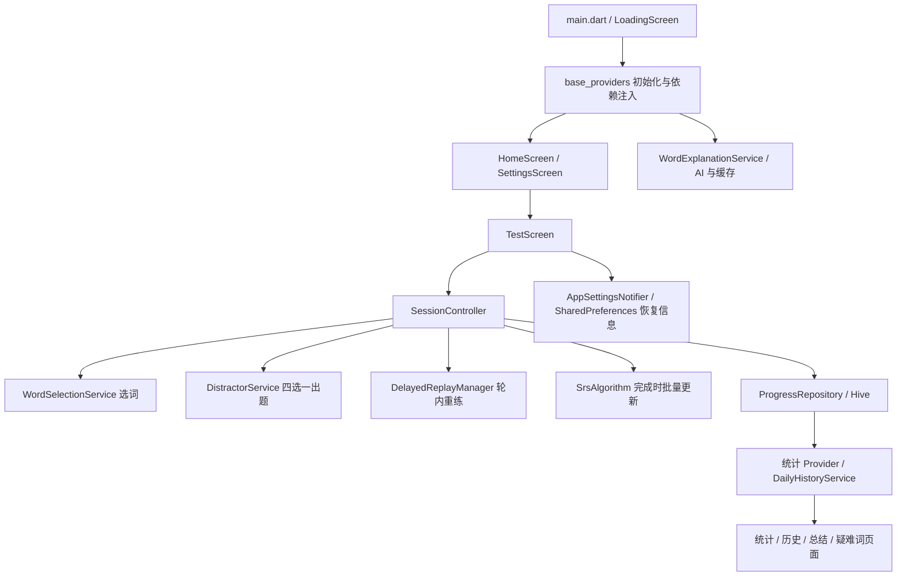
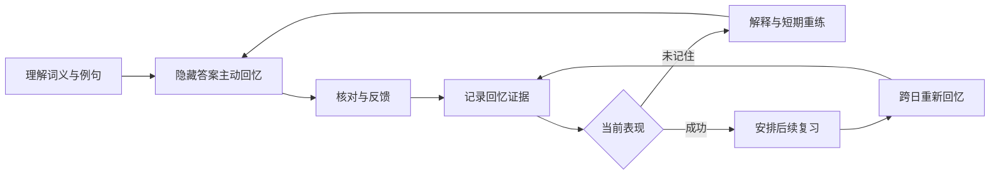
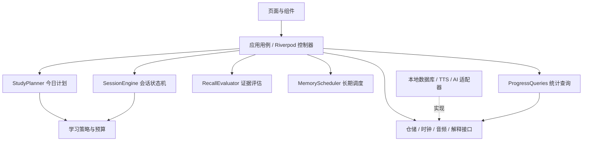
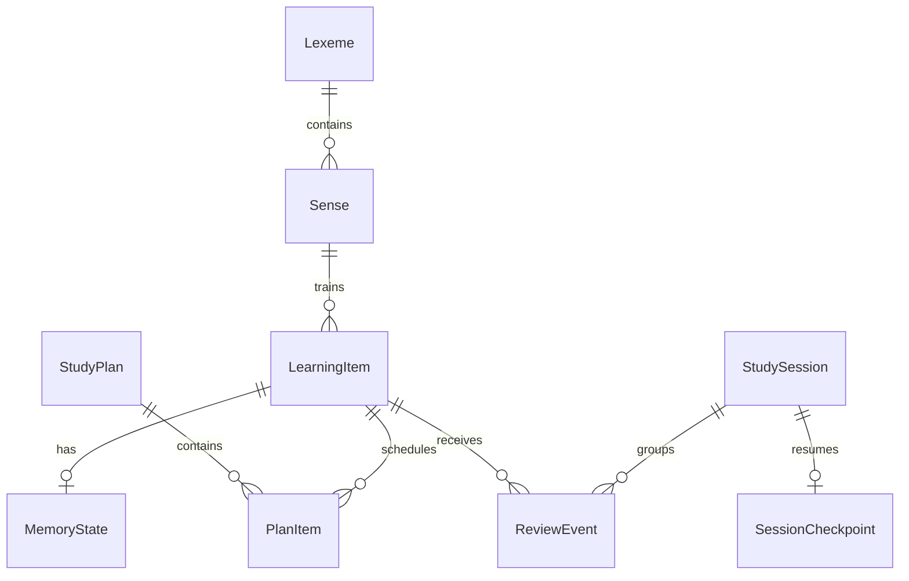
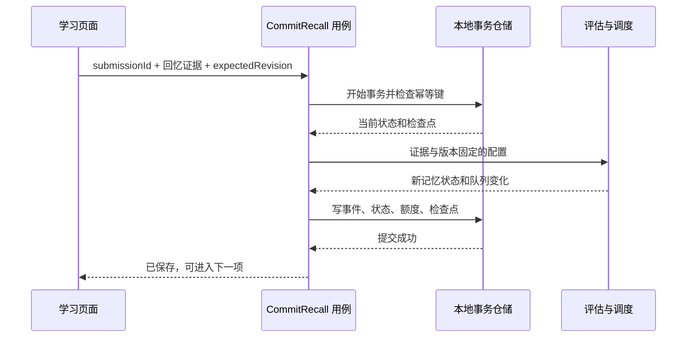

# 单词记忆核心架构设计规划

日期：2026-09-11。状态：阶段 0–6 的实现与验证已落地；本文保留需要真实用户跨日观察和人工内容审核的边界。对象：当前工作区 `vocab_flash_test`，包含已有未提交修改。

**建议把产品从“完成一轮限时词汇测试”调整为“每天完成适量回忆，并逐步形成可靠的长期记忆”。技术上保留 Flutter 和 Riverpod，采用模块化单体；先解决学习记录与记忆状态的一致性，再增加主动回忆和更成熟的调度。**

本规划基于入口、页面、会话控制、选词、SRS、模型、Hive 仓储、设置、AI 解释、历史统计及现有测试文件的静态阅读，并统计了内置词库。阶段 0–6 已落地：移动端和 macOS 核心写入默认使用 SQLite，Hive 作为迁移源和测试/兼容适配器；FSRS 以影子调度器接入；英文产出、按能力独立的计划、暂不学习偏好、疑难干预、观察窗口、有界 AI 缓存和安全凭据存储已经进入应用闭环。具体交付与验证见 `docs/重构升级实施状态.md`。

## 1. 当前软件的真实结构

### 1.1 技术与内容基线

| 项目 | 当前事实 |
|---|---|
| 应用 | `pubspec.yaml` 版本 0.3.2+1；界面名称“词汇闪测” |
| 客户端 | Flutter，Dart SDK 约束 `^3.9.0`；该约束不是 Flutter 版本 |
| 状态管理 | Riverpod，核心为 `StateNotifier<SessionData>` |
| 持久化 | Hive 保存词库、卡片、答题与测试轮次；SharedPreferences 保存设置、恢复信息和 AI 解释缓存 |
| 题型 | `Question` 固定四个选项，围绕单词中文释义选择 |
| 调度 | 自定义 SRS；到期词优先；错答、超时和慢答触发轮内延迟重出 |
| 扩展 | TTS、多主题、每日历史、疑难词、统计、AI 简释与详解、模型测速 |
| 内置词库 | 3,177 条记录：A1 900、A2 867、B1 870、B2 540；没有 C1/C2 数据 |

README 的 A1–C2 描述与当前资源不一致；3,177 是词条记录数，不直接等于去重词形数或学习者词汇量。

### 1.2 当前调用链



当前已经有分层雏形，但模块边界更多是文件类型，业务职责仍相互穿插：

- `session_controller.dart` 905 行：选词编排、出题、计时、TTS、评分、恢复、持久化、SRS 更新。
- `base_providers.dart` 472 行：启动、依赖装配、业务查询、统计及 AI Provider。
- `hive_progress_repository.dart` 682 行：存储之外还包含掌握判定相关操作、选词查询和统计。
- `settings_screen.dart` 2,625 行、`stats_screen.dart` 1,642 行、`test_screen.dart` 1,118 行：页面承担较多功能与布局分支。
- `models` 同时包含 Hive/JSON 注解与领域规则；`CardState` 引用 SRS 策略，SRS 又依赖模型。
- `domain/testset.dart` 还有另一套选词生成器；在 `lib` 搜索仅发现其定义，主会话实际使用 `WordSelectionService`。后续应先核对测试用途再收敛。

行数只是定位线索，真正需要改变的是职责与依赖方向。

### 1.3 应保留的已有能力

到期优先、新词日上限、疑难词专练、轮内重练次数上限、暂停时停止计时、同日复测降低稳定度增长、掌握要求跨日成功记录、答题记录去重，以及已有算法与会话回归测试，均值得保留。无需推倒重写。

### 1.4 核心问题与证据

| 优先级 | 代码事实 | 对单词记忆的影响 | 目标改动 |
|---|---|---|---|
| P0 | `_finishSession` 先标记 finished，再依次保存轮次、答案、SRS；更新失败主要打印日志，SRS 返回值未用于完成判定 | 存在“界面完成但进度未完整落盘”的失败窗口 | 每次提交原子记录；完成态以提交结果为准 |
| P0 | 中途只保存答案，SRS 整轮结束才更新 | 做过一部分后放弃，已发生的学习不能及时进入调度 | 有效回忆逐条更新，轮次仅是容器 |
| P0 | 恢复把主队列、延迟队列和当前题压成 wordId 列表，并写入设置 | 恢复缺少延迟剩余量、重试次数、题目与评分配置快照 | 独立、带版本的 SessionCheckpoint |
| P0 | `WordSelectionService` 构建牌组时扣新词额度 | 用户尚未学习便消耗额度；取消和恢复难以准确计数 | 第一次实际接触提交时计数，按词条去重 |
| P1 | 一个 wordId 只有一个 CardState | 看懂英文、回忆英文、听懂、拼写无法区分 | 引入学习项 LearningItem，能力状态独立 |
| P1 | `calculateQuality` 用正确性与时限反应速度决定质量；批处理没有传入已有 rtP50 | 速度与记忆证据混合，预期的个人基线未完整进入该路径 | 独立 RecallEvaluator，保存原始证据 |
| P1 | `markWordKnown` 写 stability=20、longTermReviews=2；旧适配器按稳定度补跨日次数 | 自报认识和迁移推断可被当成实测掌握 | 保存证据来源，分开显示自报与验证 |
| P1 | `retentionRate` 实际赋值为测试加权正确率；每日历史按轮次开始日期归档 | 同轮反复答对可能美化“留存”；跨午夜记录归日不准 | 回忆事件日期与首次跨日回忆指标 |
| P1 | 词库只有空 box 自动导入，强制重载会先清空 | 内容更新缺版本映射保障 | 内容版本、稳定 ID、增量迁移 |
| P2 | AI、设置、统计与核心学习入口交织 | 新增题型和调整学习流程牵动面大 | 业务模块拆分，AI 作为可选辅助 |

当前 SRS 使用 FSRS v4 形式的遗忘曲线，但稳定度、难度与间隔更新为自定义规则；因此应称“自定义 SRS”，不称完整 FSRS。官方文档分别定义了各版本公式和 Again/Hard/Good/Easy 评分，不能直接把现有 q=1/3/4/5 当作官方评分输入。[FSRS 算法文档](https://github.com/open-spaced-repetition/awesome-fsrs/wiki/The-Algorithm)

## 2. 产品目标与边界

### 2.1 记住的定义

“记住一个词”必须说明：在哪种提示下，能回忆哪种内容，在多长间隔后仍然成功。产品第一目标是**在可承受的每日时间内，提高跨日、未看答案的回忆成功率**。

能力分成四类：词义理解、英文产出、听力理解、拼写。第一版只落实词义理解与英文产出；拼写和听力随后扩展。不要为每个词一次生成所有能力卡，避免任务成倍膨胀。

“未学／学习中／复习中／重学中”是调度阶段；“需要帮助”是诊断标签；“暂不学习”是用户选择；“较稳固”是带条件的派生结论。这几种概念不使用一个布尔值表达。

### 2.2 设计假设

默认面向中文母语、以个人英语词汇记忆为目标的用户，优先手机和平板、离线可用。默认一次约 5–10 分钟；首次可建议每日 10 个新词，但允许调整。这些是可验证的产品初值，不是研究证明的最佳参数。

本轮不引入账号、社交排行、云同步、课程商城或完整英语教学体系。目标架构保留扩展边界，但当前不建设服务端和微服务。

### 2.3 学习闭环



间隔学习强调把回忆机会分散到不同时间，而不是集中刷完。由此提出本产品的设计取舍：轮内重练用于纠错，跨日回忆用于评估长期表现；具体间隔由调度器和实测反馈决定。[Retrieval Practice：Spacing](https://www.retrievalpractice.org/spacing/)

## 3. 用户流程与信息架构

建议三个主入口：**今日、词库、进步**；设置放次级入口，疑难词归入“需要帮助”，历史归入“进步”。

| 页面 | 首要问题 | 核心内容 |
|---|---|---|
| 今日 | 现在该学什么？ | 继续学习、到期复习、新词额度、预计时间、开始按钮 |
| 学习 | 我能否回忆出来？ | 提示→回忆→揭示→反馈；按需展开释义与例句 |
| 词条详情 | 我哪里不熟？ | 各能力状态、具体义项、来源、回忆历史、疑难原因 |
| 词库 | 我要学哪些词？ | 级别与词书、搜索、已选范围、暂不学习 |
| 进步 | 隔天还记得吗？ | 到期回忆成功率、任务负担、不同词条数、能力覆盖 |
| 设置 | 如何适合我的节奏？ | 时间预算、新词上限、声音、字体、备份；高级设置折叠 |

今日页示意（数值为示例）：

```text
今日学习                         设置
预计 8 分钟 · 当前目标 A2

到期复习 24 项     新词最多 8 个
[ 继续上次学习 / 开始今日学习 ]

需要帮助 3 个词        查看
今日已学 12 个不同词 · 18 次练习
今日目标完成后可选择额外练习

今日              词库             进步
```

复习任务用“项”，新词用“个词”，统计练习用“次”，防止多能力卡和重复作答混淆。

### 3.1 首次使用

选择学习范围和每日时间→展示真实可用级别→用少量示例体验回忆方式→生成第一份计划。自报已认识的词进入后续验证，不直接伪造成功复习次数。

### 3.2 新词学习

先看核心释义、发音和一条例句；点击继续时记录首次接触。隐藏答案后回忆，揭示答案，再选择“没想起／费力想起／想起／很轻松”。只有揭示前的尝试是回忆证据，看答案是 Exposure。

选择题保留为辅助识别和原有“闪测”模式。主动回忆可先使用自评，不必第一版实现自由中文语义自动判分；记录 `evaluationSource=selfReport`，不与客观题结果混为一种证据。

### 3.3 到期复习

默认无强制 2 秒倒计时，允许思考后揭示。闪测可显式开启限时，单独报告速度表现。超时表示该条件下未完成，跳过表示未评估，暂停和音频失败不是答错。

英文产出需给出义项或例句语境，避免“一个中文释义对应多个正确英文”导致误判。内容不足时不生成该题型。

### 3.4 错词与结束

错误后给简短解释、易混区别或例句，插入其他词之后再试；到重试上限时转入“需要帮助”，停止重复轰炸。没有足够间隔时结束本轮，将未成熟重练任务保存到后续计划，不为了清空队列立即重出。

用户随时可结束，已提交学习有效。总结显示“不同词条、回忆次数、待重学、下次复习”，不用完成 100 道题作为有效学习的门槛。

## 4. 目标技术架构

采用**按业务模块组织的单体应用，模块内按 presentation / application / domain / data 分层**。保留 Flutter 和 Riverpod；领域层是纯 Dart，不依赖 Flutter、Riverpod、Hive、HTTP 或页面生命周期。



依赖约束：UI 发命令和渲染状态；应用层组织提交；领域层决定规则；数据层实现读写。统计只能读取事实与投影，不反向修改记忆；AI 无权更新调度。

### 4.1 模块职责

| 模块 | 负责 | 不承担 |
|---|---|---|
| lexicon | 词条、义项、词书、内容版本、题型素材校验 | 用户记忆状态 |
| memory | MemoryState、评分策略、长期调度、掌握证据 | 页面计时与网络 |
| study | 计划、时间预算、会话状态机、短期重练、提交用例 | AI 内容生成 |
| progress | 按日期与能力聚合、趋势、回忆历史 | 另造掌握规则 |
| assistance | 本地解释、TTS、AI 补充、缓存 | 正确答案权威来源与 SRS |
| preferences | 学習偏好、显示与音频设置 | 活跃队列、答案、额度事实 |
| data_management | 迁移、备份、恢复、完整性检查 | 学习策略 |

新目录示意：

```text
lib/
  app/                     # bootstrap、routes、依赖装配
  core/                    # Clock、ID、错误类型等少量共用基础
  features/
    lexicon/{domain,application,data,presentation}/
    memory/{domain,application,data}/
    study/{domain,application,data,presentation}/
    progress/{application,data,presentation}/
    assistance/{application,data,presentation}/
    preferences/{application,data,presentation}/
    data_management/{application,data,presentation}/
  shared_ui/               # 主题 token、按钮、排版、响应式外壳
```

无需给每个模块机械创建空目录；先迁移一个完整用例。手机和平板使用同一学习组件，只替换布局容器。

### 4.2 关键接口（概念契约）

```dart
StudyPlan plan(PlanningSnapshot input, StudyPolicy policy, DateTime now);
Evaluation evaluate(RecallEvidence evidence, EvaluationPolicy policy);
ScheduleDecision schedule(MemoryState before, Evaluation evidence,
    SchedulerConfig config, DateTime reviewedAt);
SessionTransition reduce(SessionSnapshot state, SessionCommand command);
Future<CommitReceipt> commitRecall(RecallSubmission submission);
```

`plan/evaluate/schedule/reduce` 不产生 I/O；随机源与时钟显式注入。`commitRecall` 由应用层调用事务仓储，带 `submissionId`、`expectedRevision`、状态与配置版本。返回已提交版本或明确错误，不能吞错后返回成功。

## 5. 数据模型

### 5.1 核心关系



| 模型 | 关键字段与约束 |
|---|---|
| Lexeme | stableId、legacyWordId、headword、lemma、contentVersion；旧数值 ID 保留映射 |
| Sense | senseId、lexemeId、pos、definition、examples、source、qualityStatus |
| LearningItem | itemId、senseId、skill、promptVariant、enabled；相同义项和能力避免重复建卡 |
| MemoryState | itemId、phase、stability、difficulty、dueAt、lastReviewedAt、lapses、revision、schedulerVersion、evidenceOrigin |
| ReviewEvent | eventId、sessionId、itemId、ordinal、occurredAtUtc、localDate、timeZoneId、taskType、result、rating、hintUsed、answerRevealed、activeDurationMs、evaluationSource、contentVersion、policyVersion、schedulerVersion |
| ExposureEvent | eventId、lexemeId、sessionId、occurredAtUtc、localDate；实际接触事实，与回忆分开 |
| StudyPlan / PlanItem | planId、studyDate、budget、itemId、reason、priority、status；保存选择理由 |
| StudySession | sessionId、mode、startedAt、endedAt、status、configSnapshot；状态 active/paused/completed/abandoned |
| SessionCheckpoint | sessionId、revision、currentQuestionSnapshot、stage、mainQueue、relearnQueue、retryCounts、activeElapsed、lastCommittedEventId |
| UserWordPreference | lexemeId、selfDeclaredKnown、suspended、manualDifficult；用户声明不伪造回忆 |
| DailySummary | 按事件投影的可重建缓存，包含统计口径版本 |

长期调度以学习项为单位；日新词额度以首次接触的 Lexeme 为单位。词书成员关系独立保存，跨词书同一词条不重复记忆。

### 5.2 证据规则

- 客观题结果、自评回忆、提示后答对、选择题识别、自由练习、迁移推断分别标识。
- 同一 item 在同一 learning day 的短期纠错，不增加“独立跨日成功”次数；该指标只是展示证据，调度仍按真实 elapsed time 计算。
- “较稳固”由能力范围、独立复习证据及当前状态派生，允许下降；不能理解成永久掌握。
- 历史 ReviewEvent 不随设置变化重新改写；需要重新分析时生成带版本的分析结果。
- 词义理解成功不能直接写成英文产出成功；新能力从未评估开始。
- 旧记录无法恢复的 hint、题型细节等保存 unknown，不用虚构的默认值补成高质量证据。

## 6. 今日计划与调度

### 6.1 分开两个引擎

**MemoryScheduler** 决定某个学习项下一次何时复习；**StudyPlanner** 决定今天有限时间内实际选哪些项目；**RelearningPolicy** 决定会话内纠错何时重出。三个职责独立，避免“轮内第几题再出现”干扰“几天后复习”。

### 6.2 计划优先级

1. 恢复已开始的会话，核对已提交事件，剔除已经完成的任务。
2. 在预算内安排已成熟重学与到期项，对重学设置上限，避免困难词占满全部时间。
3. 到期集合按逾期程度和预计记忆风险排序，保持稳定的同分顺序。
4. 使用剩余预算引入新词；积压超过预算时自动减少新词，可降到零。
5. 提前复习只在用户选择“额外练习”时加入，并标记证据类型；不为凑题量自动填满。

预算初式：`可用新词数 = min(日剩余额度, floor(剩余秒数 / 新词预计耗时))`。耗时使用同题型的实际活跃时间估计，冷启动用保守默认值。预算是软结束点，不在回忆途中强制截断。

计划预览不扣额度。首次接触由回忆事务写入持久化 `ExposureEvent`；计划器每次用该事实重新核对当日额度，因此 UI 偏好写入中断也不会重新开放额度。多个学习项属于同一词条只扣一次。重开页面和重复请求不重复扣减；一个显式的空计划不会回退到全词库选词。

### 6.3 算法演进决策

第一阶段用 `LegacySchedulerAdapter` 包装现有算法并固定版本，以便隔离结构变更与算法变更。第二阶段引入版本固定、与参考实现一致性验证通过的 FSRS 适配器；具体 Dart 实现选型在实施时检查维护状态、许可与测试，不在规划中锁死未经验证的包。

迁移前不能把现有 difficulty 1.2–3.0 原样当成另一模型参数。历史充分的学习项可用映射后的真实记录重放；历史不足的保持旧调度或走明确的冷启动转换，并显示待验证。目标回忆率可先用 0.90 作为候选初值，但不得当成产品对实际记忆效果的保证。[FSRS 算法与间隔定义](https://github.com/open-spaced-repetition/awesome-fsrs/wiki/The-Algorithm)

先做影子计算：同一批事件同时产出候选间隔，仅旧算法生效；比较未来任务量、极端间隔、同日重练和迟到复习。行为测试通过不代表学习效果更优，还需跨日使用验证。

## 7. 可靠提交与恢复

### 7.1 存储取舍

目标使用支持事务与查询索引的本地关系数据库保存学习核心数据，候选为 SQLite；Flutter 绑定在实施时验证目标平台后选择。理由是一次学习同时改变事件、状态、额度和检查点，需要明确的事务边界。3,177 条词库本身不构成换库理由。

第一阶段可以保留 Hive，通过单一写入口与持久化提交日志补偿；但必须实现恢复协议，不能把几个 `put` 当作跨 box 原子事务。建议先在 Hive 上建立适配接口，随后一次性切换核心写入，避免长期双写。

SharedPreferences 只保留轻量偏好；AI 缓存使用独立、有容量限制的缓存仓储。凭据放平台安全存储接口，备份排除凭据。

### 7.2 每次回忆的提交协议



可以立即展示反馈，但只有提交成功才推进持久进度。失败保留当前题并显示可重试状态；重试使用同一 submissionId。每个 session 串行处理命令，revision 拒绝过期提交，避免计时器与点击同时答题。

崩溃在事务前：恢复同一题；崩溃在事务后、UI 更新前：按已提交检查点继续。完成轮次只修改 session 状态和汇总，不再次批量应用 SRS。

### 7.3 时间与生命周期

领域接收可注入的 Clock；耗时采用活跃时长，暂停不累积。UTC 用于排序与间隔；事件另存提交时的学习日期和时区，旧历史不随旅行重新归日。切到后台先暂停输入与计时，再保存，避免等待 I/O 时继续倒计时。

恢复当前题的提示、答案顺序、题型和阶段；后台期间不自动超时。配置变化只作用于下一轮，当前轮使用快照。

## 8. 内容与 AI 边界

先把现有 Word 导入为稳定词条和“待细分的传统义项集合”，不要用逗号或中文释义列表机械拆成不同义项。人工或经校验的内容处理再逐步细化 Sense。

每种题型有内容资格检查：无可靠释义不出词义题；无明确语境不出英文产出题；无可用音频不出听力题。保留现有干扰项生成，但增加同义答案、重复选项和多答案冲突校验。

AI 仅按需提供解释、助记、例句和易混比较，保存生成来源、模型与内容版本，并允许报告问题。核心答案与长期记忆评分不依赖在线生成；超时、离线或无凭据时退回本地释义。

缓存键包含词条/义项、语言、内容版本与生成模板版本；设置容量上限和清理策略。AI 模型配置与测速移到高级设置，不占学习主路径。

## 9. 统计口径

| 指标 | 建议定义 | 排除或单独展示 |
|---|---|---|
| 今日新词 | 当日首次有效接触的不同 Lexeme 数 | 计划选中但未接触 |
| 今日练习 | 已提交 ReviewEvent 数 | 重复 submission、演示数据 |
| 今日词条 | ReviewEvent 涉及的不同 Lexeme 数 | 同词重复计数 |
| 到期回忆成功率 | 到期项首次、无提示回忆成功数 / 合格到期回忆数 | 同日纠错、提前刷题；客观与自评分组 |
| 7/30 日观察 | 指定学习队列在对应间隔窗口的首次有效回忆表现，并显示样本量 | 未观测不能算成功或失败 |
| 复习负担 | 到期任务数、预计活跃分钟、逾期分布 | 不把不同词条数当任务数 |
| 能力覆盖 | 分能力的已学习和较稳固项目数 | 不跨能力直接折算词汇量 |

“预测可回忆率”必须标注为模型估计；现有选择题正确率改名为“练习正确率”。未完成会话的已提交事件计入学习，完成轮次数单独统计。跨午夜按每条事件的 localDate 聚合。

关键效果指标是跨日表现与负担的共同改善；连续打卡天数作为辅助。评估时同时报告缺测比例，避免只观察坚持用户而高估效果。

## 10. 迁移与回滚

1. 先记录工作区基线和已有测试结果，保存用户现有未提交改动，不自动覆盖。
2. 导出带 schemaVersion、contentVersion、数量与校验和的旧库备份，排除密钥。
3. 在新库暂存区迁移；旧库仍为权威，迁移失败不切换。
4. 建立 legacyWordId→Lexeme/LearningItem 映射；旧记忆仅映射到 legacy recognition 能力，不复制成产出、拼写掌握。
5. Attempt 用稳定迁移键去重；关联可确定的 session。无法确定归属的单独标记，不猜造配置。已有 CardState 作为迁移基线，不把全部旧 Attempt 再套一次造成重复学习。
6. 旧 longTermReviews 的推断来源无法可靠区分时标记 legacyUnverified。未知义项与损坏记录进入迁移报告，不静默丢弃。
7. 恢复未完成轮次时承认旧检查点信息不足：保留已答事实，将剩余词转成恢复任务，不声称精确还原旧延迟队列。
8. 核对词条映射、事件数量、日期、抽样状态与孤立引用，通过后写迁移完成标记并切换单一写入端。
9. 首次新库写入前可直接回旧库；新库已产生事件后只能使用兼容的新版本回滚应用，或显式导出转换新增记录。不能直接切回旧库导致新增学习丢失。

阶段开关分别控制存储迁移、计划器、新题型和新调度器；避免一次发布同时改变所有核心行为。旧数据库只读保留至验证完成。

## 11. 分阶段实施计划

以下为单名熟悉 Flutter 的开发者的粗略净工作日估算，不包含全部词条人工编辑、上架等待与长期效果观察；应在阶段 0 后重估。

| 阶段 | 交付物 | 完成门槛 | 估算 |
|---|---|---|---|
| 0：建立基线 | 流程清单、现有测试结果、数据样本与口径清单、设计决策记录 | 能解释一次答题如何落盘与恢复；已知失败有记录 | 1–2 日 |
| 1：可靠学习内核 | CommitRecall、幂等键、配置快照、Checkpoint、额度按接触计数；适配旧算法 | 杀进程、重复提交、半轮结束不丢已提交学习、不重复 SRS | 4–6 日 |
| 2：数据边界 | Lexeme/LearningItem、事务仓储、旧数据迁移与回滚验证 | 旧数据可恢复且来源可追踪；只有一个核心写入端 | 4–7 日 |
| 3：核心体验 | 今日预算计划、主动回忆、短轮随时结束、统一手机平板组件 | 从新词理解到跨日复习完整可用；离线核心路径通过 | 4–6 日 |
| 4：调度与统计 | 候选 FSRS 适配器、影子计算、事件统计、能力状态 | 参考向量一致；历史不重复更新；统计可重算 | 3–5 日 |
| 5：扩展 | 有内容保障的英文产出、疑难干预、AI 缓存整理；听写按需求追加 | 多能力互不污染，素材缺失有降级 | 3–5 日 |
| 6：可靠性收口 | 真实 Android SQLite 集成测试、事务回滚、能力级计划、用户暂不学习、安全凭据、迁移故障注入 | 真实设备通过幂等/重启/回滚；错误不伪装成完成；计划不跨能力合并 | 2–4 日 |

完整范围约 21–35 个净工作日。当前实现覆盖阶段 0–6；FSRS 仍处于影子调度阶段，必须在足够跨日样本上比较后才能替换线上旧调度器。

### 11.1 建议任务拆分

| 任务 | 依赖 | 主要涉及现有文件 |
|---|---|---|
| 提取时间、评分与提交契约 | 阶段 0 | `domain/srs.dart`、`session/session_controller.dart` |
| 独立恢复检查点与配置快照 | 提交契约 | `screens/test_screen.dart`、`session/app_settings_notifier.dart` |
| 统一事件写入与幂等 | 提交契约 | `data/progress_repository.dart`、`data/hive_progress_repository.dart` |
| 新词计数改为 Exposure | 统一写入 | `session/word_selection_service.dart`、设置日额度逻辑 |
| LearningItem 与迁移器 | 可靠写入 | `models/word.dart`、`models/card_state.dart`、生成适配器 |
| StudyPlanner 替换选词入口 | 新模型 | `word_selection_service.dart`；核对并收敛 `domain/testset.dart` |
| SessionEngine 与题型接口 | Checkpoint、新模型 | `session_controller.dart`、`session_models.dart`、`models/question.dart` |
| 事件统计与历史页 | 新事件落盘 | `base_providers.dart`、`daily_history_service.dart`、统计页面 |

调整旧行为时同步改有意依赖该行为的测试，例如“选中就扣额度”“固定 2 秒”。保留无意回归检查，不为了让旧断言通过而维持已弃用规则。

## 12. 验收与性能目标

### 12.1 必须通过的场景

| 场景 | 预期 |
|---|---|
| 提交前后分别杀进程 | 题目或下一检查点准确恢复；已提交事件不丢失 |
| 点击与超时同时发生、重复回调 | 一个 submission 只产生一个事件与一次状态变化 |
| 完成第 7 题后放弃本轮 | 7 条有效记录参与后续调度与统计 |
| 新词计划后退出 | 未接触不扣额度；接触后重启只扣一次 |
| 后台停留 10 分钟 | 暂停时间不计入作答耗时、不变成错误 |
| 同词连续即时练习 | 不产生虚假的多次跨日掌握证据 |
| 23:59 学到 00:01 | 各事件归正确学习日期；不会重复消费额度 |
| 修改偏好后恢复 | 使用原会话配置；后续新会话使用新设置 |
| 自报认识或导入旧掌握 | 标识来源，不显示为新实测成功 |
| 迁移中断后重试 | 不重复事件、不破坏旧库、输出同一映射 |
| 新库写入后回滚 | 新记录保留；不能无提示回到旧进度 |
| 离线、TTS 失败、AI 超时 | 基础词义学习可继续；听力题按资格降级 |
| 内容更新删除或拆分词条 | 旧事件仍可解释；映射不串词 |

测试分为纯领域确定性测试、真实存储事务/故障注入测试、关键 Widget 流程测试和真实设备生命周期测试。现有测试文件可提供回归基线，但内存替身不能证明真实持久化一致性。

实现期执行直接 Dart analyzer、`flutter test --no-pub`、Android debug 构建，并在真实 Android 设备运行 SQLite 提交、幂等、能力隔离、重启恢复和导入回滚集成测试。Flutter 分析服务器在当前环境仍会因自身 JSON `FormatException` 中断；这不对应源代码诊断。macOS runner 已生成，但当前环境 CocoaPods 无效，macOS 集成测试暂不能启动。

### 12.2 非功能目标（待基线校准）

学习题切换本地 p95 小于 150ms，事务提交 p95 小于 200ms；在约 10 万条事件下，今日计划与近 30 日统计 p95 小于 500ms。以上是待测目标，不是当前性能结果。索引优先考虑 dueAt、itemId+occurredAt、sessionId+ordinal、localDate；题目页不全量扫描历史。

统计投影可重建，采用分页读取历史。字体缩放和读屏标签进入验收；正确/错误不能只用颜色表达。学习日志默认本地，诊断日志不输出凭据和用户原文答案。

## 13. 决策记录与待验证项

| 决策 | 原因 | 何时重新评估 |
|---|---|---|
| 保留 Flutter/Riverpod，模块化单体 | 问题在领域边界与一致性，换框架不能解决 | 平台范围发生实质变化 |
| 回忆事件为事实，MemoryState 为可追踪状态 | 学习不应依赖整轮完成 | 无需回退到轮次批处理 |
| 先稳定记录，再升级算法 | 避免坏数据进入更复杂调度 | 事件与迁移验收通过 |
| 词条与能力项分离，按需启用 | 避免把识别当产出且控制任务量 | 用户明确只需识别训练 |
| 事务型核心存储，偏好独立 | 答题、状态、额度、检查点需要共同提交 | 目标平台绑定验证失败 |
| AI 辅助、离线主流程 | 内容生成不应决定能否学习 | 产品目标改变 |

待持续观察：用户实际每日预算、词库义项质量、FSRS 影子结果与真实跨日留存。已完成的工程门槛包括 Android SQLite 真实绑定、事务回滚、迁移故障注入、内容资格降级、凭据不进入偏好配置，以及按学习能力隔离的计划和状态。

最终交付顺序：**先让每次学习都可靠生效，再让用户每天知道学什么，随后提高回忆方式与调度质量，最后扩展题型和辅助内容。**
